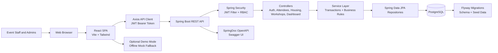
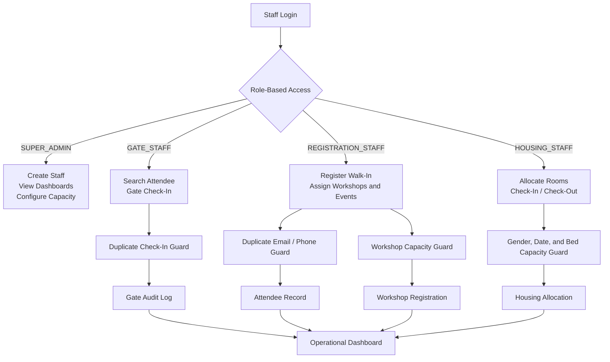
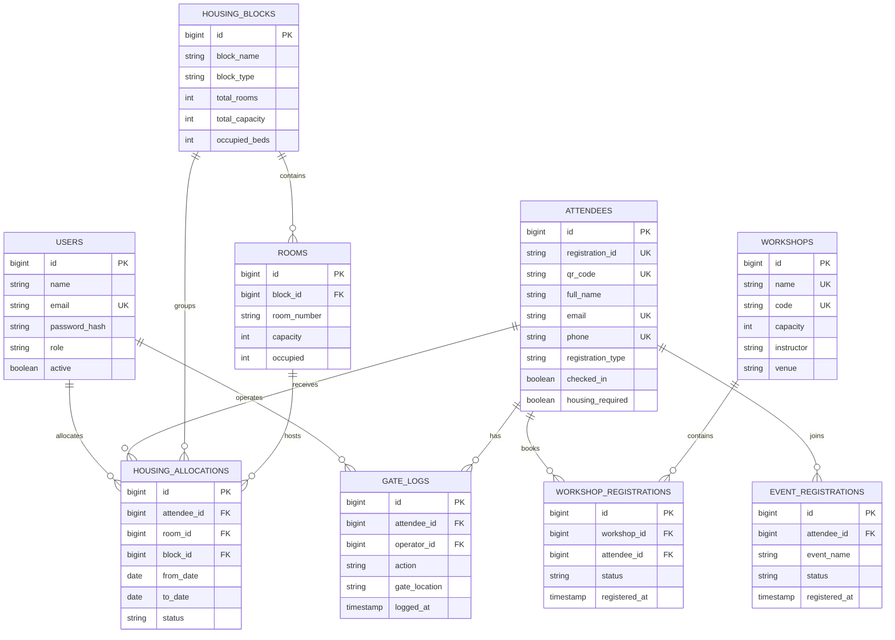

# VORTEX'26 EventOps Command Center

A full-stack event operations platform for managing attendee registration, gate admissions, accommodation, workshop capacity, staff access, and operational dashboards for a large college or technical symposium.

## Business Problem

Large campus events are difficult to run when gate staff, registration desks, housing teams, and organizers work from separate spreadsheets or manual lists. The most common failures are slow entry lines, duplicate check-ins, inconsistent walk-in records, room overbooking, workshop overcapacity, and limited visibility for organizers during event day.

VORTEX'26 centralizes those workflows into a role-based staff dashboard so each operations team can work from the same source of truth.

## Target Users

- **Super admins**: oversee event operations, staff access, dashboards, capacity settings, and configuration.
- **Gate staff**: search attendee records and perform gate check-ins.
- **Registration staff**: register walk-in attendees and manage workshop participation.
- **Housing staff**: allocate rooms while respecting gender, date, and capacity rules.
- **Organizers**: monitor registration, check-in, workshop, and housing metrics.
- **Attendees**: benefit indirectly through faster entry, cleaner accommodation handling, and fewer event-day errors.

## Feature Overview

| Feature | Operational Need |
| --- | --- |
| Staff authentication and RBAC | Restricts sensitive workflows by role: `SUPER_ADMIN`, `GATE_STAFF`, `REGISTRATION_STAFF`, and `HOUSING_STAFF`. |
| Gate admissions | Allows staff to verify attendees by registration ID, QR text, or email and prevents duplicate check-ins. |
| Walk-in registration | Captures attendee details, payment metadata, competitions, workshop choices, and housing requests. |
| Attendee directory and profile | Gives staff a 360-degree view of attendee details, gate logs, accommodation history, workshops, and events. |
| Accommodation management | Tracks hostel blocks, room capacity, gender compatibility, date ranges, check-in, checkout, and allocation history. |
| Workshop management | Maintains session capacity, confirmed participants, cancellations, participant search, and CSV export. |
| Dashboard analytics | Shows attendance, walk-ins, pending entry, housing demand, housing occupancy, and workshop/competition distribution. |
| Audit logging | Records successful and duplicate gate check-in attempts with operator and gate information. |

## Tech Stack

**Frontend**
- React 19
- Vite 8
- Tailwind CSS
- TanStack Query
- Axios
- React Router
- Recharts
- Lucide React

**Backend**
- Spring Boot 3.3
- Kotlin 2.0
- Java 21
- Spring Security
- JWT with JJWT
- BCrypt password hashing
- Spring Data JPA / Hibernate
- Bean Validation
- SpringDoc OpenAPI

**Database and Deployment**
- PostgreSQL 17
- Flyway migrations
- Docker Compose
- Nginx frontend container

## Architecture Overview

The platform uses a React single-page application, a Spring Boot API, JWT-based staff authentication, transactional service-layer business rules, and a Flyway-managed PostgreSQL database. The diagrams below are written in Mermaid so they render directly on GitHub.

### System Architecture



### Event Operations Flow



### Core Data Model



The backend follows a layered structure:

- `controller`: HTTP routing, validation entry points, role guards
- `service`: business rules, transactions, duplicate prevention, capacity checks
- `repository`: JPA queries, locked reads for sensitive workflows
- `model/entity`: persisted domain objects
- `model/dto`: API request/response contracts
- `db/migration`: versioned schema and seed data

## Security Model

- Login is public at `POST /api/auth/login`.
- Staff creation at `POST /api/auth/register` is restricted to `SUPER_ADMIN`.
- Public users cannot self-register or choose arbitrary roles.
- Passwords are hashed with BCrypt.
- JWT secrets are read from environment variables.
- CORS allowed origins are environment-driven.
- Controllers use method-level role guards for staff workflows.

Important production values must not use local defaults:

- `APP_JWT_SECRET`
- `SPRING_DATASOURCE_PASSWORD`
- `APP_CORS_ALLOWED_ORIGINS`

## Database Design Summary

Core tables:

- `users`: staff accounts and roles
- `attendees`: pre-registered and walk-in attendee records
- `gate_logs`: check-in audit trail
- `housing_blocks`: hostel or accommodation blocks
- `rooms`: room-level bed capacity
- `housing_allocations`: date-based room assignments and checkout history
- `workshops`: workshop/session metadata and capacity
- `workshop_registrations`: participant registrations and cancellations
- `event_registrations`: competition/event participation records

Safety-oriented schema additions include:

- Sequence-backed attendee registration IDs
- Unique attendee email and phone constraints
- Unique confirmed workshop registration per attendee/session
- Indexed lookup fields for attendee search and gate operations

## API Overview

Authentication:

- `POST /api/auth/login`
- `POST /api/auth/register` - `SUPER_ADMIN`
- `GET /api/auth/me`

Attendees and gate:

- `GET /api/attendees`
- `GET /api/attendees/search?q=...`
- `GET /api/attendees/{id}`
- `GET /api/attendees/{id}/profile`
- `POST /api/attendees/walk-in`
- `POST /api/attendees/check-in`

Housing:

- `GET /api/housing/blocks`
- `GET /api/housing/dashboard`
- `GET /api/housing/allocations`
- `POST /api/housing/allocate`
- `PATCH /api/housing/allocations/{id}/check-in`
- `PATCH /api/housing/allocations/{id}/check-out`
- `PATCH /api/housing/rooms/{id}/capacity`

Workshops:

- `GET /api/workshops`
- `POST /api/workshops`
- `PUT /api/workshops/{id}/capacity`
- `GET /api/workshops/{id}/participants`
- `GET /api/workshops/{id}/export`
- `POST /api/workshops/{id}/register`
- `POST /api/workshops/{id}/cancel`

Dashboard:

- `GET /api/dashboard/stats`

Swagger UI is available locally at:

```text
http://localhost:8080/swagger-ui.html
```

## Local Development

### 1. Start PostgreSQL

```bash
docker run --name vortex-postgres \
  -e POSTGRES_DB=vortex26 \
  -e POSTGRES_USER=vortex_admin \
  -e POSTGRES_PASSWORD=vortex2026 \
  -p 5432:5432 \
  -d postgres:17-alpine
```

### 2. Start the backend

```bash
cd server
./gradlew bootRun
```

Windows:

```powershell
cd server
.\gradlew.bat bootRun
```

### 3. Start the frontend

```bash
cd client
pnpm install
pnpm dev
```

Frontend:

```text
http://localhost:5173
```

Backend:

```text
http://localhost:8080
```

## Docker Setup

Copy the example environment file and change production-sensitive values as needed:

```bash
cp .env.example .env
```

Run:

```bash
docker compose up --build
```

Services:

- Frontend: `http://localhost:5173`
- Backend API: `http://localhost:8080`
- PostgreSQL: `localhost:5432`

Validate Compose configuration:

```bash
docker compose config
```

## Environment Variables

| Variable | Purpose | Local Default |
| --- | --- | --- |
| `POSTGRES_DB` | PostgreSQL database name | `vortex26` |
| `POSTGRES_USER` | PostgreSQL username | `vortex_admin` |
| `POSTGRES_PASSWORD` | PostgreSQL password | `vortex2026` |
| `SPRING_DATASOURCE_URL` | Backend database URL | `jdbc:postgresql://localhost:5432/vortex26` |
| `SPRING_DATASOURCE_USERNAME` | Backend DB username | `vortex_admin` |
| `SPRING_DATASOURCE_PASSWORD` | Backend DB password | `vortex2026` |
| `APP_JWT_SECRET` | JWT signing secret, minimum 32 bytes | Local dev secret |
| `APP_JWT_EXPIRATION_MS` | JWT lifetime | `604800000` |
| `APP_CORS_ALLOWED_ORIGINS` | Allowed frontend origins | `http://localhost:5173,http://localhost:3000` |
| `VITE_API_URL` | Frontend API base URL | `/api` |
| `VITE_ENABLE_DEMO_MODE` | Enables offline mock fallback | `false` unless explicitly set |

## Local Demo Accounts

These are seeded for local development and demos only.

| Role | Email | Password |
| --- | --- | --- |
| Super Admin | `admin@vortex26.com` | `Admin@vortex26` |
| Gate Staff | `gate@vortex26.com` | `Admin@vortex26` |
| Housing Staff | `housing@vortex26.com` | `Admin@vortex26` |
| Registration Staff | `reg@vortex26.com` | `Admin@vortex26` |

Change or remove demo credentials before any real deployment.

## Testing and Verification

Backend tests:

```bash
cd server
./gradlew test
```

Backend build:

```bash
cd server
./gradlew bootJar
```

Frontend lint:

```bash
cd client
pnpm lint
```

Frontend production build:

```bash
cd client
pnpm build
```

The backend test suite covers:

- Login success and failure
- Staff creation permissions
- Role-based access behavior
- Attendee search
- Walk-in duplicate email/phone prevention
- Duplicate gate check-in prevention
- Housing gender/date/capacity validation
- Workshop duplicate and over-capacity registration

## Screenshots

Screenshots are not included yet. Recommended screenshots:

- Command Center dashboard
- Gate Admissions check-in result
- Walk-in Registration form
- Accommodation room matrix
- Workshop capacity management
- Attendee profile modal

## Production Deployment Checklist

- Replace all local/demo secrets.
- Use a strong `APP_JWT_SECRET` from a secret manager.
- Set production CORS origins explicitly.
- Remove or rotate demo staff accounts.
- Use managed PostgreSQL with backups.
- Run Flyway migrations before serving traffic.
- Serve the frontend through HTTPS.
- Put the backend behind HTTPS or a trusted reverse proxy.
- Configure structured logging and monitoring.
- Add rate limiting for login and high-traffic endpoints.
- Run realistic load/concurrency tests for gate and allocation workflows.
- Disable `VITE_ENABLE_DEMO_MODE` in production.

## Known Limitations and Future Improvements

- QR support is currently based on QR/registration code text input; browser camera scanning is not implemented.
- Dashboard refresh is polling-based, not WebSocket streaming.
- Payment handling stores payment metadata; it does not integrate with a payment gateway.
- The frontend has an optional offline mock mode for demos. It is disabled unless `VITE_ENABLE_DEMO_MODE=true`.
- Capacity workflows use database transactions and pessimistic locks, but production-level guarantees should still be validated with concurrent load tests on the target database.
- Frontend bundle size could be improved with route-level code splitting.

## Resume Bullets

- Built a full-stack EventOps command center using React, Spring Boot, Kotlin, and PostgreSQL to manage gate admissions, walk-in registration, accommodation allocation, workshop capacity, and live event dashboards.
- Implemented JWT authentication and role-based access control for super admin, gate, registration, and housing staff workflows, preventing public self-registration and unauthorized staff actions.
- Designed transactional business workflows to reduce duplicate check-ins, duplicate walk-in records, room overbooking, and workshop overcapacity using database constraints, locked reads, and validation-focused services.
- Added backend integration tests covering authentication, RBAC, attendee search, duplicate prevention, housing validation, and workshop capacity behavior.
