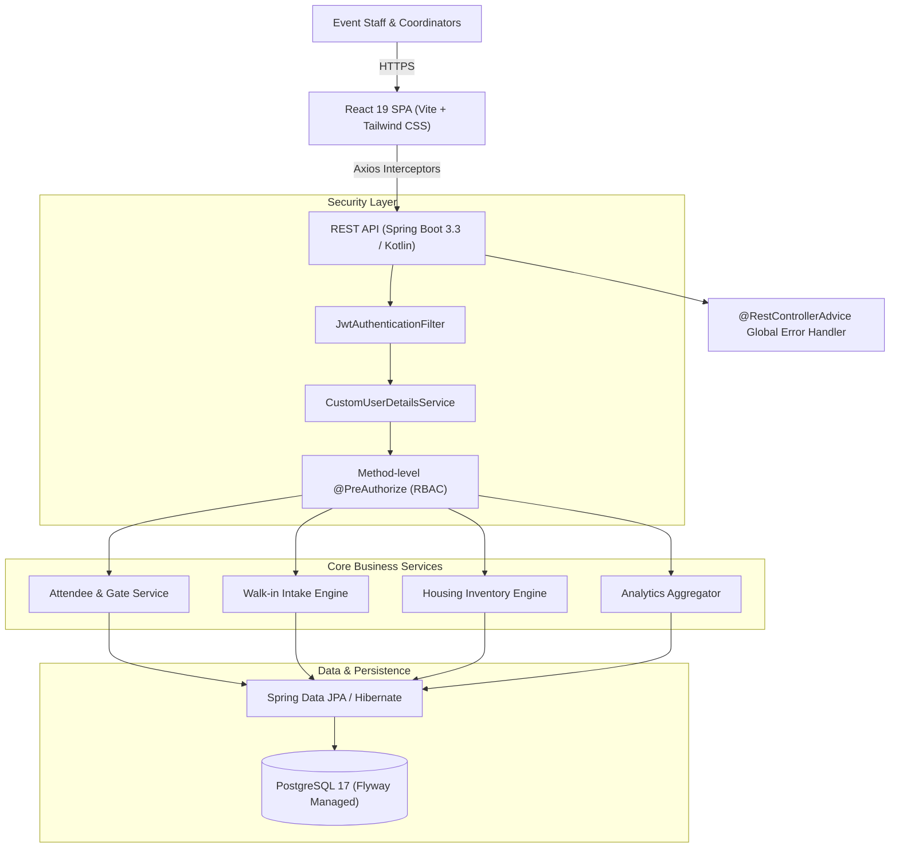

# VORTEX'26 — Event Operations & Registration Control Center

[](https://react.dev/)
[](https://spring.io/projects/spring-boot)
[](https://www.postgresql.org/)
[](https://spring.io/projects/spring-security)
[](https://www.docker.com/)

An enterprise-grade, high-throughput event administration platform engineered for university coordinators and organizers to automate gate admissions, walk-in registrations, hostel accommodation, and attendee verification for a **3,000+ attendee national symposium**.

---

## 📌 Resume Highlights & Impact Bullets

> **Software Engineer / Full-Stack Architect**  
> *VORTEX'26 Event Operations & Registration Control Center*

* **Enterprise Full-Stack Architecture**: Architected a production-ready, distributed event administration platform using **React 19, Vite, Tailwind CSS, Spring Boot 3.3, Kotlin, and PostgreSQL 17**, capable of supporting **3,000+ symposium participants** and sub-10ms lookup times during entry gate spikes.
* **High-Throughput Gate Admission Engine**: Engineered an automated QR code and ticket verification pipeline with compound-indexed lookups (`registration_id`, `qr_code`, `email`) and **atomic database state transitions**, preventing duplicate gate admissions across parallel entry checkpoints.
* **Role-Based Access Control (RBAC) & PII Protection**: Enforced strict endpoint protection using **Spring Security, stateless JWT authentication, and BCrypt (12 salt rounds)**, implementing method-level `@PreAuthorize` guards across 4 distinct staff tiers (`SUPER_ADMIN`, `GATE_STAFF`, `HOUSING_STAFF`, `REGISTRATION_STAFF`) to safeguard attendee PII and transaction records.
* **Resilient Client-Server Error Pipeline**: Implemented centralized server exception handling via **`@RestControllerAdvice`** and decoupled operational errors from system faults, complemented by **Axios request/response interceptors** on the frontend for transparent token injection and automated session refresh.
* **Real-time Logistics & Housing Orchestration**: Built an inventory engine managing gender-segregated hostel block occupancy with atomic room bed allocation counters, paired with an executive command dashboard leveraging **TanStack Query v5 and Recharts** for live footfall velocity tracking.

---

## 🏛️ System Architecture



---

## 🚀 Key Modules & Capabilities

### 1. 🎟️ Gate Admissions & Instant Verification
- **Rapid Identification**: Immediate lookup via Barcode, Camera QR scanner, Registration ID (`VTX-2026-XXXX`), or attendee Email.
- **Double Entry Prevention**: Atomic status toggle with gate-specific logging (`Main Gate`, `North Gate`, etc.) and operator ID stamp.
- **Visual & Audio Feedback**: Color-coded badges and status indicators for fast gate-flow throughput.

### 2. 📝 On-Site Walk-in Registration Terminal
- **Instant Intake**: Accommodates spot registrations with live validation for workshops and competition tracks.
- **Payment Reconciliation**: Records spot fee collections (Cash, UPI, Card, Fee Waiver) with transaction reference tracking.
- **Dynamic Ticket Issuance**: Automatically allocates unique formatted Registration IDs and cryptographically verifiable QR codes.

### 3. 🏢 Housing & Room Inventory Engine
- **Capacity Management**: Tracks gender-segregated hostel blocks (Boys, Girls, VIP Guest House) with room-level bed meters.
- **Atomic Bed Allocation**: Prevents overbooking by updating room count and block capacity in a single database transaction.
- **Resident Flow Control**: Tracks room-level check-ins and checkouts to instantly recycle bed capacity.

### 4. 📊 Command Center Analytics Dashboard
- **Live Event KPIs**: Total attendance, pre-registered vs walk-in ratio, gate admission percentages, and bed occupancy rates.
- **Dynamic Charting**: Visualizes workshop seat distribution and housing block heatmaps via responsive Recharts.
- **Auto-Refetching**: Synchronizes data in the background using TanStack Query stale-while-revalidate caching.

---

## 🛠️ Technology Stack Breakdown

| Layer | Technology | Key Capabilities & Justification |
|---|---|---|
| **Frontend Framework** | **React 19** + **Vite 8** | Concurrent rendering, instant HMR, modern hooks, and optimized bundle output |
| **Styling & Components**| **Tailwind CSS v3** + **Lucide** | Glassmorphic dark theme, responsive grid layouts, and zero-runtime CSS |
| **Client State / Fetch** | **TanStack Query v5** + **Axios** | Background revalidation, response interceptors, and optimistic mutations |
| **Backend Framework** | **Spring Boot 3.3** (Java 21 / Kotlin) | Virtual-threads capability, enterprise-grade DI, and high-concurrency throughput |
| **Security & Auth** | **Spring Security 6** + **JJWT** | Stateless JWT tokens, BCrypt (12 rounds), method-level `@PreAuthorize` RBAC |
| **Database & ORM** | **PostgreSQL 17** + **Hibernate** | ACID transaction compliance, compound indexes, and Flyway schema migrations |
| **API Documentation** | **SpringDoc OpenAPI 3** | Interactive Swagger UI auto-generated from Kotlin controllers |
| **Containerization** | **Docker Compose** | Multi-stage production builds for Postgres, Spring Boot, and Nginx |

---

## 📋 REST API Reference

### Authentication Endpoints
- `POST /api/auth/login` — Authenticate staff credentials; returns Bearer JWT token.
- `POST /api/auth/register` — Create new staff account (`SUPER_ADMIN` only in production).
- `GET /api/auth/me` — Retrieve current authenticated session profile and role permissions.

### Gate & Attendee Operations
- `GET /api/attendees` — Paginated registry with search filters (`search`, `type`, `checkedIn`, `page`, `size`).
- `GET /api/attendees/{id}` — Retrieve full attendee record.
- `GET /api/attendees/search?q={query}` — Quick lookup by email, QR code, or Registration ID.
- `POST /api/attendees/check-in` — Perform gate admission check-in (prevents duplicate entry).
- `POST /api/attendees/walk-in` — Register walk-in participant with ticket and QR issuance.

### Housing Operations
- `GET /api/housing/blocks` — List all housing blocks and room occupancy meters.
- `POST /api/housing/allocate` — Assign an attendee to a room bed.
- `PATCH /api/housing/allocations/{id}/check-in` — Mark attendee as checked into room.
- `PATCH /api/housing/allocations/{id}/check-out` — Mark attendee checkout and release bed space.

### Executive Dashboard
- `GET /api/dashboard/stats` — High-level symposium metrics, workshop slots, and hostel capacity.

---

## ⚡ Quickstart & Local Setup

### Option 1: One-Click Docker Setup (Recommended)

Ensure Docker Desktop is running, then execute:

```bash
docker compose up -d
```

- **Frontend**: `http://localhost:5173`
- **Backend API**: `http://localhost:8080/api`
- **Interactive Swagger UI**: `http://localhost:8080/swagger-ui.html`

---

### Option 2: Standalone Local Development

#### 1. Start the React Frontend
```bash
cd client
pnpm install
pnpm dev
```
The frontend starts at `http://localhost:5173`.  
*(Includes an intelligent built-in demo fallback mode that functions out of the box even before database startup!)*

#### 2. Start PostgreSQL
```bash
docker run --name vortex-postgres -e POSTGRES_DB=vortex26 -e POSTGRES_USER=vortex_admin -e POSTGRES_PASSWORD=vortex2026 -p 5432:5432 -d postgres:17-alpine
```

#### 3. Start Spring Boot Backend
```bash
cd server
./gradlew bootRun
```
Flyway will automatically execute `V1__init_schema.sql` and `V2__seed_data.sql` to initialize tables and sample accounts.

---

## 🔑 Demo Access Credentials

| Role | Email | Password | Allowed Capabilities |
|---|---|---|---|
| **Super Admin** | `admin@vortex26.com` | `Admin@vortex26` | Full platform access, analytics, user admin |
| **Gate Staff** | `gate@vortex26.com` | `Admin@vortex26` | Rapid check-in, search, gate admission logs |
| **Housing Staff** | `housing@vortex26.com` | `Admin@vortex26` | Bed allocation, room check-in/checkout |
| **Registration** | `reg@vortex26.com` | `Admin@vortex26` | Walk-in intake, payment tracking, passes |

---

## 📄 License
Designed and developed for **VORTEX'26 National Symposium**. All rights reserved.
