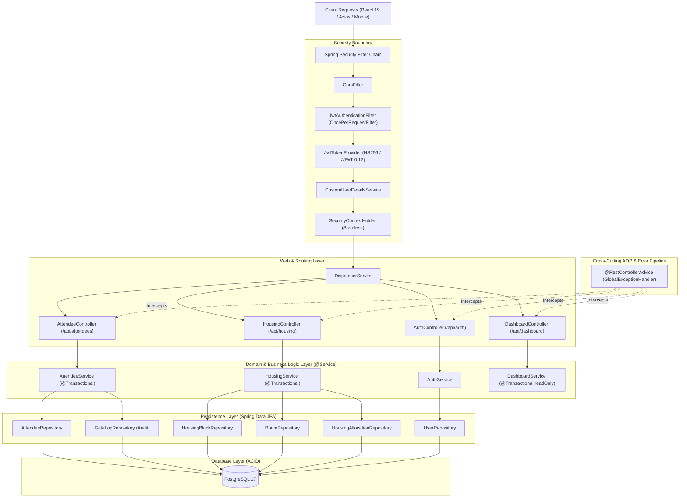

# VORTEX'26 Backend Architecture & Engineering Concepts

## 1. High-Level Architecture Overview

The backend is built as an **Enterprise Hexagonal / Layered Architecture** leveraging **Spring Boot 3.3**, **Kotlin 2.0**, and **Java 21 LTS**, with **PostgreSQL 17** managed through **Flyway versioned migrations**.

---

## 2. Core Engineering Concepts & Design Patterns

### A. Layered Clean Architecture (Separation of Concerns)
1. **Controllers (`/controller`)**: Thin presentation layer. Validates HTTP input via Jakarta Bean Validation (`@Valid`), delegates to services, and returns strongly-typed `ResponseEntity<T>`.
2. **DTOs (`/model/dto`)**: Data Transfer Objects isolate internal database entities from external wire representation, preventing over-posting attacks and PII leaks.
3. **Services (`/service`)**: Encapsulates business logic, transactional boundaries (`@Transactional`), domain validation, and atomic state transitions.
4. **Repositories (`/repository`)**: Spring Data JPA interfaces leveraging Spring query derivation and optimized JPQL with compound indexes.
5. **Entities (`/model/entity`)**: JPA models representing PostgreSQL tables with lifecycle timestamps (`@CreationTimestamp`, `@UpdateTimestamp`).

---

### B. Security & Identity Management (Defense-in-Depth)
* **Stateless JWT Authentication (`JJWT 0.12`)**:
  - Implemented as a `OncePerRequestFilter` (`JwtAuthenticationFilter`).
  - Cryptographically signed using HMAC-SHA256 (`Keys.hmacShaKeyFor`) with raw 256-bit entropy.
  - Claims parsing extracts subject email, verifies expiration, and populates `SecurityContextHolder`.
* **Method-Level Role-Based Access Control (RBAC)**:
  - Enabled via `@EnableMethodSecurity(prePostEnabled = true)`.
  - Granular annotations guard endpoints (e.g., `@PreAuthorize("hasAnyRole('SUPER_ADMIN', 'GATE_STAFF')")`).
  - Segregates responsibilities across `SUPER_ADMIN`, `GATE_STAFF`, `HOUSING_STAFF`, and `REGISTRATION_STAFF`.
* **Cryptographic Password Hashing**:
  - `BCryptPasswordEncoder(12)` provides exponential cost protection against brute-force / dictionary attacks.

---

### C. Concurrency Control & High-Throughput Gate Operations
* **Double-Check-In Prevention**:
  - Uses `@Transactional` isolation and single-query compound lookups (`registrationId OR qrCode`).
  - Gate check-in atomically flags `checkedIn = true`, records timestamp, operator, and gate entrance.
  - Secondary check-in attempts return deterministic 200 responses with `alreadyCheckedIn = true` and warning alerts.
* **Immutable Audit Trail (`GateLog`)**:
  - Every admission attempt generates an immutable `GateLog` entry recording operator ID, entrance gate (`Main Gate`, `VIP Entrance`), and timestamp for event forensics.

---

### D. Housing & Hostel Bed Inventory Engine
* **Gender-Segregated Block Modeling**:
  - **Hostel Garnet A (Boys)** & **Hostel Opal C (Girls)**.
  - Capacity counters: `totalCapacity`, `occupiedBeds`, and derived `availableBeds`.
* **Atomic Bed Allocation & Release**:
  - In `HousingService.allocateRoom()`: Atomic increment on room occupancy and block occupied beds inside a database transaction.
  - In `HousingService.roomCheckOut()`: Atomically frees the bed, decrements block occupancy, and marks the allocation record as checked out.

---

### E. Centralized Error Handling & Exception Pipeline
* **`@RestControllerAdvice` (`GlobalExceptionHandler`)**:
  - Completely eliminates repetitive `try/catch` boilerplate in controllers.
  - Distinguishes **Operational Errors** (subclasses of custom `AppException` such as `ConflictException`, `ResourceNotFoundException`, `BadRequestException`) from **System Errors** (500 Internal Server Error).
  - Intercepts `MethodArgumentNotValidException` to return structured field-level validation errors.

---

### F. Flyway Versioned Database Migrations
* Database schema is versioned in code under `src/main/resources/db/migration`:
  - `V1__init_schema.sql`: DDL creating relational tables, foreign keys, array types, and high-performance b-tree indexes (`idx_attendees_qr_code`, `idx_attendees_registration_id`).
  - `V2__seed_data.sql`: DML seeding default staff accounts, Garnet A & Opal C hostels, rooms, and realistic participants.

